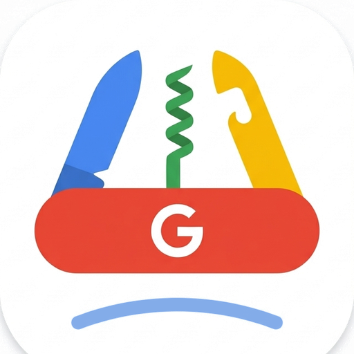
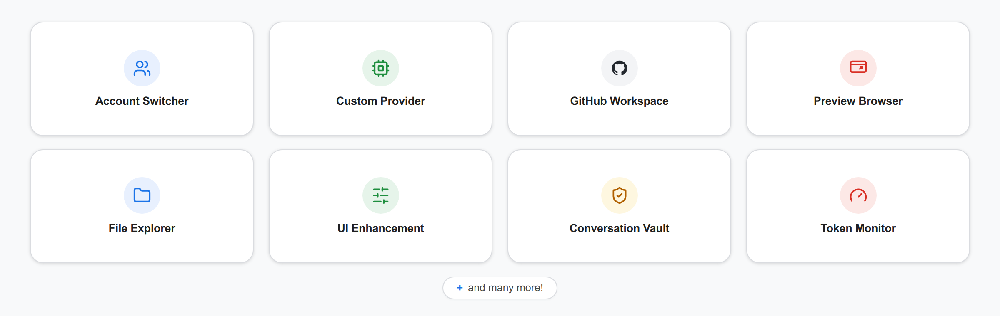
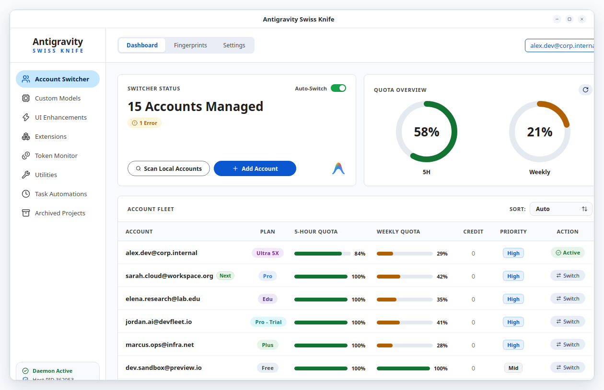

<p align="center">
  
</p>

<h1 align="center">Antigravity Swiss Knife</h1>

<p align="center">
  Cross-platform desktop companion and background daemon for Google Antigravity.
</p>

<p align="center">
  <a href="#overview">Overview</a> &nbsp;•&nbsp;
  <a href="#key-features">Features</a> &nbsp;•&nbsp;
  <a href="#quick-start">Quick Start</a> &nbsp;•&nbsp;
  <a href="#gui-examples">GUI Examples</a> &nbsp;•&nbsp;
  <a href="#frequently-asked-questions">FAQ</a> &nbsp;•&nbsp;
  <a href="#documentation-wiki">Wiki</a> &nbsp;•&nbsp;
  <a href="#license">License</a>
</p>

---

## Overview

Antigravity Swiss Knife is a cross-platform desktop companion and background daemon for Antigravity 2.0, CLI  and VS Code Extension, while adhering Google's Terms of Service.

>As a new open-source project in active development, community feedback would be really appreciated :heart:.  
Please feel free to raise issues, report bugs, or suggest feature ideas in our GitHub repository to help shape upcoming releases.

## Key Features

<p align="center">
  
</p>

## Quick Start

### Installation

Download ready-to-run installers from [Releases](https://github.com/ChillingWombat/AntigravitySwissKnife/releases):

<table class="markdown-table">
  <tr><th>Platform</th><th>Package Format</th><th>Install Location</th></tr>
  <tr><td>Linux</td><td>.deb package</td><td>/opt/antigravity-swiss-knife</td></tr>
  <tr><td>Windows</td><td>NSIS installer (.exe)</td><td>%LOCALAPPDATA%\Programs\Antigravity Swiss Knife</td></tr>
  <tr><td>macOS</td><td>Disk Image (.dmg)</td><td>/Applications/Antigravity Swiss Knife.app</td></tr>
</table>

### Linux Dedicated Out-of-Tree Installer

To install directly from source into your user directory (`~/.local/share/antigravity-swiss-knife`):

```bash
npm run install:linux
```

This bundles the companion daemon, installs desktop icons, and configures the desktop menu entry.

### Building from Source

```bash
git clone https://github.com/ChillingWombat/AntigravitySwissKnife.git
cd AntigravitySwissKnife
npm install
npm run build
npm run desktop
```

To run only the headless companion daemon:

```bash
./bin/swiss daemon --web --addr 127.0.0.1:8765
```

## GUI Examples

<p align="center">
  
</p>

## Frequently Asked Questions

1. **What platforms does Antigravity Swiss Knife support?**  
- It runs on 64-bit Linux (`.deb` and source installer), Windows 10/11 (NSIS installer), and macOS (Apple Silicon and Intel `.dmg`). 
- Linux is the primary development platform while Windows and macOS packages have been validated inside Quickemu virtualized environments.

2. **Does it use an API proxy server?**  
- No. Intercepting API traffic between your IDE and Google endpoints risks credential exposure and violates Google Cloud Terms of Service. 
- Swiss Knife operates purely through direct local OS keyrings, SQLite WAL coordination, and native Chrome DevTools Protocol hooks on your machine.
- If you really need such feature, please check projects like [CLIProxyAPI](https://github.com/router-for-me/CLIProxyAPI).

3. **Will my account get banned for using the Account Switcher?**  
- No, Google only bans relevant services for account that was acquired illicitly, but not for using account switcher. 
- Account rotation updates OAuth refresh tokens inside your operating system's native keyring exactly as official login sessions do. 
- It also virtualizes hardware identifiers per account to prevent identity collision and telemetry linkage.

4. **Can I use separate Google accounts for subagents?**  
- No, spawning subagents across different Google accounts concurrently as a pool causes session race conditions and violates Terms of Service. 
- Swiss Knife limits Google account switching strictly to the primary orchestrator session. Subagent offloading is designed exclusively for Custom Models, keeping Google account usage isolated and compliant.

5. **How are my credentials stored and secured?**  
- All sensitive credentials remain strictly on your local machine and are encrypted at rest with AES-256-GCM  
- You can configure an optional application access master password to gate application  entry.


7. **Why doesn't  this proejct support third-party subscription accounts as custom models?**  
- Frontier models are co-trained and optimized alongside their native agent runtimes and toolchains. Running Claude outside Claude Code or GPT outside Codex loses the prompt tuning, tool protocols, and scaffold optimizations that give each model its edge. 
- While avoiding vendor lock-in sounds appealing, models deliver their best results inside their native environments. 
- Antigravity had rough edges early on, but Google's sufficient resources will  keep Gemini and the Antigravity runtime consistently competitive for daily development eventually and meet most people's needs.
8. **If Custom Models don't replace Gemini, how should I work with other frontier models?**  
- Custom Models in Swiss Knife (BYOK API keys or local Ollama) serve as backups, cost-saving alternatives, and auxiliary subagents when Gemini quota runs low. They handle overflow and specialized tasks rather than replacing the primary daily driver. 
- The cleanest way to work with external frontier models is to run each one in its native agent application and connect them with Antigravity through open Agent Communication Protocols (ACP). Each agent should stay in its optimized environment while collaborating across projects.

## Documentation Wiki

Comprehensive architecture specs, multi-app fleet guides, and developer workflows are documented in the [GitHub Wiki](https://github.com/ChillingWombat/AntigravitySwissKnife/wiki):

- [Features Index](https://github.com/ChillingWombat/AntigravitySwissKnife/wiki/Features): Dedicated guides for all 12 navigation sections.
- [Architecture & Multi-Process Daemon](https://github.com/ChillingWombat/AntigravitySwissKnife/wiki/Architecture-and-Multi-Process-Daemon): Inter-process communication, SQLite WAL protection, and CDP runtime injection.
- [Multi-App Fleet Sync & Account Switching](https://github.com/ChillingWombat/AntigravitySwissKnife/wiki/Multi-App-Fleet-Sync-and-Account-Switching): Fleet modes, standby quota rotation, OS keyrings, and hardware fingerprint virtualization.
- [Active Conversation Continuation & Subagent Revival](https://github.com/ChillingWombat/AntigravitySwissKnife/wiki/Active-Conversation-Continuation-and-Subagent-Revival): Session detection, intent store, layout pinning, and automated CDP continuation.
- [ACP Agent Mesh Expansion](https://github.com/ChillingWombat/AntigravitySwissKnife/wiki/ACP-Agent-Mesh-Expansion): Registered agent nodes, GUI vs CLI node architecture, and handshake protocol.
- [Packaging, VM Validation & Installation](https://github.com/ChillingWombat/AntigravitySwissKnife/wiki/Packaging,-VM-Validation-and-Installation): Cross-platform release builds, Quickemu VM testing (Windows 11 & macOS), and Git worktrees.
- [Security, Compliance & Cache Management](https://github.com/ChillingWombat/AntigravitySwissKnife/wiki/Security,-Compliance-and-Cache-Management): Google Terms of Service alignment, zero-proxy architecture, and cache pruning.
- [Project Roadmap](https://github.com/ChillingWombat/AntigravitySwissKnife/wiki/Roadmap): Milestone history and planned fine-grained token breakdown (skills vs harness overhead).
- [Credits & Acknowledgements](https://github.com/ChillingWombat/AntigravitySwissKnife/wiki/Credits): Open-source libraries, protocol standards, and tools.

## License

This project is licensed under the [MIT License](LICENSE).

Antigravity Swiss Knife is an independent community project. It is not affiliated with, sponsored by, or endorsed by Google LLC.
